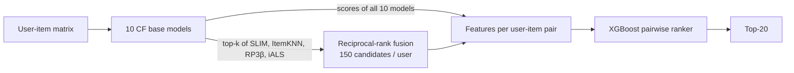

# Two-Stage Recommender — PoliMi Recommender Systems Challenge 2025-2026

My solo solution to the [Recommender Systems Challenge 2025-2026](https://www.kaggle.com/competitions/recommender-systems-2025-challenge-polimi), the Kaggle competition of the Recommender Systems course at Politecnico di Milano (Nov 2025 – Jan 2026).

**Task:** recommend 20 new movies to each user from implicit feedback only. About 3.8M interactions, 27k users, 7k items; random 80/20 holdout; metric **Recall@20**.

| | Recall@20 |
|---|---|
| Best public leaderboard score (submission v5) | **0.51605** |
| Final private leaderboard score (submission v7, team *Noooocooked*, 1 person) | **0.51440** — rank 26 / 71 |
| Winning team, private leaderboard | 0.53149 |
| Final score / winning score | 96.8% |

The best public score and the final score come from two different submissions; [see below](#why-the-best-public-score-is-not-the-final-score) for why.

## Approach



**Stage 1 — base models.** Ten collaborative-filtering models, hyperparameters tuned with Optuna on a train/validation holdout. Recall@20 of each model on that validation split:

| Model | Recall@20 |
|---|---|
| SLIM ElasticNet | 0.2863 |
| EASE-R | 0.2800 |
| RP3β | 0.2495 |
| iALS (`implicit`) | 0.2449 |
| SLIM BPR | 0.2415 |
| ItemKNN CF (TF-IDF, asymmetric cosine) | 0.2359 |
| P3α | 0.2343 |
| UserKNN CF | 0.2236 |
| PureSVD | 0.2018 |
| TopPop | 0.1065 |

**Candidate generation.** The top items from four models with different inductive biases (SLIM 100, ItemKNN 50, RP3β 80, iALS 80) are merged with reciprocal-rank fusion and the best 150 per user are kept.

**Features (39 per pair).** For each of the 10 models: raw score, rank within the user's candidates, and score z-normalised per user. Plus item popularity and user profile length (raw and log), the fusion score, a hand-weighted blend (0.6 SLIM + 0.2 iALS + 0.1 RP3β + 0.1 ItemKNN), SLIM − iALS, and percentile ranks of SLIM and iALS.

**Stage 2 — reranker.** `XGBRanker` with a pairwise objective, early-stopped on NDCG@20 over a 15% split of users. Training protocol, without leakage:

1. Base models are trained on 80% of the interactions.
2. Their candidates are labelled with the held-out 20%, and the ranker is trained on those labels.
3. Base models are retrained on 100% of the data; the trained ranker scores their candidates for the submission.

`evaluate` reproduces the same steps one level down (64% / 16% / 20% test) so the local number reflects the submission setting.

## How the score got there

| Submission | Public | Private |
|---|---|---|
| ItemKNN + TopPop baseline | 0.0767 | 0.0773 |
| Modified ItemKNN | 0.2637 | 0.2648 |
| SLIM + TopPop | 0.3512 | 0.3510 |
| SLIM alone, tuned | 0.5073 | 0.5053 |
| SLIM + RP3β + EASE-R score hybrid | 0.5109 | 0.5093 |
| SLIM + iALS hybrid | 0.5113 | 0.5095 |
| XGBoost reranker v2 | 0.5127 | 0.5114 |
| **XGBoost reranker v5 (best public)** | **0.5161** | 0.5141 |
| **XGBoost reranker v7 (final score)** | 0.5158 | **0.5144** |

Linear score hybrids flattened out around 0.509. The learned reranker added the last half point.

## Why the best public score is not the final score

Each leaderboard scores a different half of the test interactions, and the final score is the best **private** score among the two submissions selected for evaluation. I did not select them by hand, so Kaggle picked my two best public submissions, v5 (public 0.51605) and v7 (public 0.51582). On the private half v7 came out ahead, 0.51440 against 0.51409, so 0.51440 became the final score. Choosing v5 explicitly would not have helped: it would have scored 0.51409.

Every submission scoring above 0.50 lost between 0.0012 and 0.0020 from public to private, so the private half is a little harder for this kind of model. v5 dropped 0.0020 and v7 0.0014: a small difference that is partly noise, but consistent with v5 being slightly more tuned to the public half. Probable reasons, from its notebook version:

- **Model selection on the public board.** The local check (Recall@20 0.296) was computed on the same validation interactions used as the reranker's training labels, so it could not be trusted, and choices were steered by the public score instead. With half the test set, a lead of 0.0002 over v7 is within noise.
- **No real validation for the ranker.** XGBoost ran a fixed 350 trees with its training data as the evaluation set, so nothing could flag overfitting.
- **Feature shift at submission time.** The ranker learned from base models trained on 80% of the data, then scored base models retrained on 100%. v5's features were mostly raw model scores and products of raw scores, whose scale changes when a model sees more data.
- **Unstable candidate set.** Up to 1,100 candidates per user were put in a Python `set` and cut to 700 in arbitrary order (the bug described below).

This repository addresses each point: the ranker is early-stopped on held-out users, raw scores are paired with per-user ranks, z-scores and percentiles that stay stable when base models are retrained, `evaluate` scores on a test split the ranker never sees, and candidates are ranked before the cut.

## Changes from the competition notebook

This repo is a cleaned-up rewrite of the latest version of my Kaggle notebook (saved after the competition, following v5 and v7). Fixing the issues below changes the pipeline, so the code is not expected to reproduce either leaderboard score to the digit.

- **Candidate cut.** The notebook merged candidates into a Python `set` and kept `[:150]`; sets are unordered, so it dropped arbitrary candidates. Candidates are now ranked by reciprocal-rank fusion before the cut.
- **Feature drift.** Training and inference built features in two different functions (inference had 3 extra columns and a renamed one). There is now one `build_features` for both, and a test checks the columns match.
- **Dead parameter.** `cutoff_candidates` was never used; `n_candidates` now controls the cut.
- **Memory.** The notebook cached a dense users × items score matrix for every model (~7.5 GB). Scores are now computed in user batches and only candidate entries are kept.
- **Library updates.** XGBoost's `gpu_hist` became `device="cuda"`, and the course framework is patched at setup for NumPy ≥ 1.24 and Cython 3.

## Setup

```bash
pip install -r requirements.txt
bash scripts/setup_framework.sh      # clones + compiles the course framework into external/
```

Put the competition files (`data_train.csv`, `data_target_users_test.csv`) in `data/`. They are not redistributed here.

```bash
python -m recsys2025 evaluate --data-dir data            # local Recall@20 vs SLIM alone
python -m recsys2025 submit --data-dir data --out submission.csv
python -m pytest tests                                   # end-to-end check on synthetic data
```

Use `--device cuda` to train the ranker on a GPU. SLIM ElasticNet is the slowest step (~20 min on 4 cores).

## Layout

```
recsys2025/
  data.py         loading, 80/20 holdout, submission writer
  base_models.py  the 10 base models and their tuned hyperparameters
  two_stage.py    candidates, features, XGBoost reranker, Recall@20
  __main__.py     evaluate / submit commands
scripts/setup_framework.sh
tests/test_two_stage.py
```

## AI assistance

Gemini was used as a coding assistant during the competition. Claude was used afterwards to turn the Kaggle notebook into this repository: restructuring the code, fixing the issues listed above, writing the tests and this README.

## Credits and license

Base models other than iALS come from [RecSys_Course_AT_PoliMi](https://github.com/MaurizioFD/RecSys_Course_AT_PoliMi) by Maurizio Ferrari Dacrema (AGPL-3.0), installed by the setup script and not included in this repo. Since this code imports it, the repo is released under **AGPL-3.0** as well. iALS uses [`implicit`](https://github.com/benfred/implicit).
